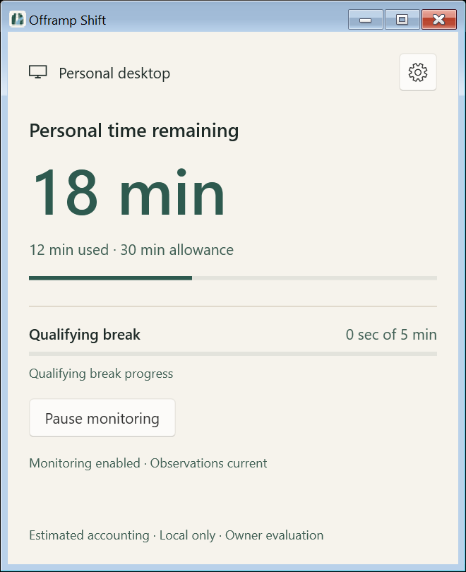
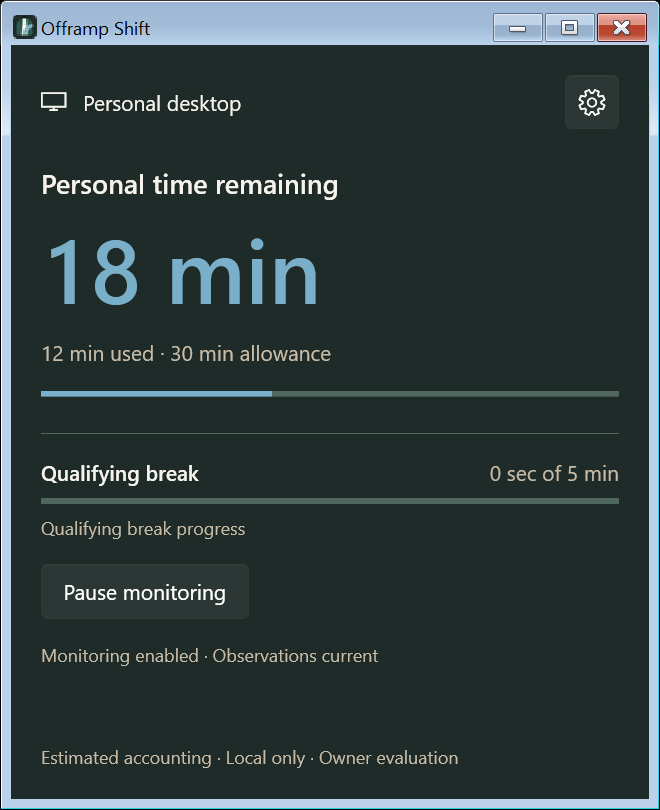
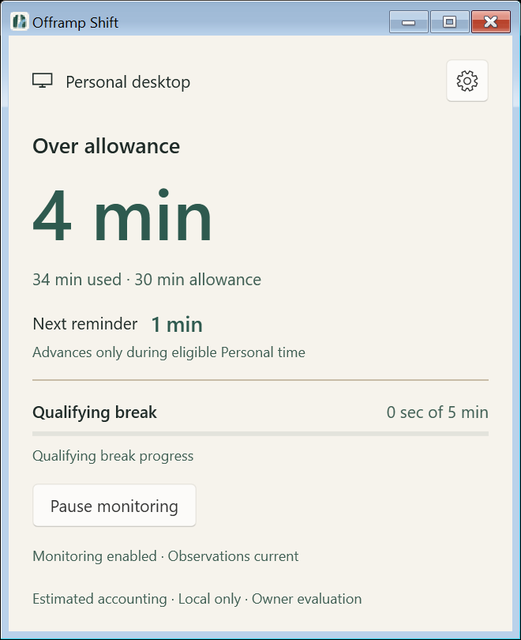
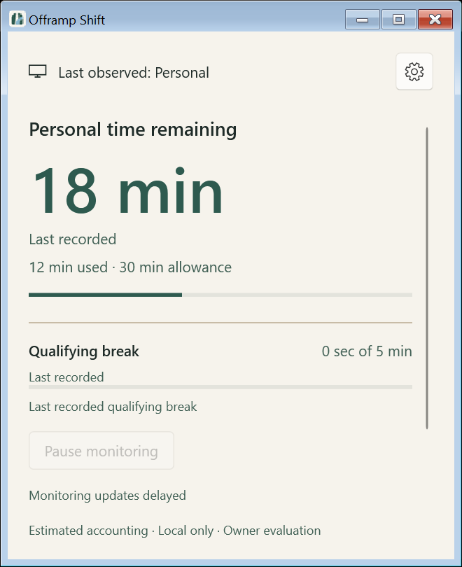
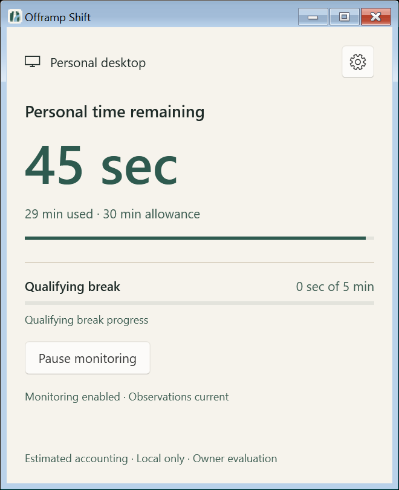
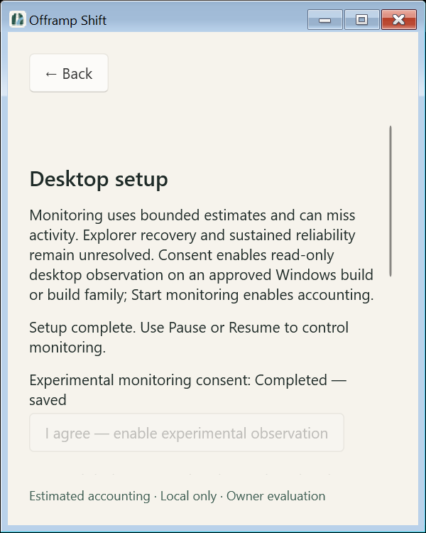

# PR A — Presentation foundation and timer-first Home

## Baseline and scope

Implementation starts from `origin/main` **81d9aab555b7568bf30415ce316769c974f1a824**,
the merged Personal Usage Accounting PR #20. The owner explicitly approved this
baseline on October 22, 2026. This records owner authorization, not an independent
third-party review or new native accounting acceptance. Branch:
`feat/timer-first-home-redesign`.

The approved final design package and subsequent corrected implementation plan
govern the layout and presentation. The attached ZIP was the available design
source; the standalone design directory was absent. Canonical repository PNG/ICO
assets remain unchanged. No logo geometry or new visual concept was introduced.

PR A includes the compact Home, Home/Settings overview/detail shell, existing
temporary settings controls, shared recorded-accounting projection, host
presentation epoch, ordinary-command coordinator and consistent tray facts.
PR B retains protected drafts, settings conflict preconditions, Diagnostics and
its separate UI preference file. PR C retains reminder visual restyling. The
existing interactive reminder, native placement, switching, notification backend,
WindowsSettings v5, SQLite schema and Core policies remain unchanged.

## Presentation contract

`DashboardModel` owns one `CommittedPresentation`. Home and `TraySummary` consume
its same immutable Ready state/configuration pair, epoch and publication sequence;
future Diagnostics can use the same projection. No display timer earns usage,
break credit or reminder progress. Durations of at least one minute retain whole
minutes (floor). Below one minute, display seconds: earned usage/overage/break
progress floor, remaining time and configured targets round up. Zero is `0 sec`;
1 ms remaining is `1 sec`, 999 ms earned is `0 sec`, and 59,999 ms remaining is
`60 sec` before the 60,000 ms boundary becomes `1 min`. No display clock is added.
Integer formatting supports durations beyond TimeSpan's range. PersonalDeferred uses the committed snooze remainder; ordinary Nudging uses
the committed repeat remainder, never concurrently. Legacy Snoozed is not treated
as PersonalDeferred. Off reminders show no countdown. A due remainder is not proof
of presentation/delivery.

Exhaustion has three presentations: Personal time remaining, Over allowance, and
Allowance exhausted when the exhaustion latch remains set with zero arithmetic
overage. Increasing allowance does not clear that latch. Work/Personal context
alone never establishes eligible charging. Inactive eligible Personal still counts
under PR #20; only qualifying Work/lock evidence earns breaks.

Host publication freshness is distinct from observation availability. Delayed
publications say Monitoring updates delayed; fresh host unavailability says
Observations unavailable when setup/storage do not explain the condition first.
An independently valid desktop scope may coexist with unavailable foreground
evidence. Historical values carry adjacent Last recorded labels. Last observed
Personal/Work requires a previously valid context. No observation timestamp,
per-provider freshness, lock/idle indicator or delivery guarantee is invented.

### Cache boundaries

`AccountingPresentationEpoch` is a process-local GUID in HostSnapshot, generated
by MonitoringApplication. It changes after prerequisites, before a potentially
changing reset, recovery, reassignment, blocked-store reopen or exact pending-save
retry/restoration. This occurs even if the operation later fails. It is never
persisted, used for eligibility, or inferred from a command's success message.

Controller snapshot sequences are globally increasing across epochs. The store
rejects earlier sequences, including skipped/out-of-order old-epoch publications.
An epoch change clears the pair before considering incoming values. Only Ready
with both State and Configuration can populate it. Ordinary PendingCommit/Blocked
may retain the previous acknowledged pair within the same epoch, explicitly
historical. RecoveryRequired, Incompatible and Disposed clear it. A failed boundary
with no Ready pair leaves values unavailable. A subsequent Ready publication
atomically replaces the complete pair, including when accounting recovery committed
but a later Windows-settings save failed. Owner termination clears the store and
prevents stale owner publications from repopulating it. Reassignment/epoch changes
also discard obsolete remembered context.

### Ordinary commands and temporary settings

The presentation coordinator reserves an ordinary mutation before awaiting the
existing host command, rejects duplicate/conflicting submissions, exposes specific
pending/result feedback and adds delayed-confirmation wording after five seconds.
That is a feedback threshold, never a deadline, retry or cancellation. Navigation
remains usable. Home and tray retain explicit failures; successful unrelated actions
do not dismiss an earlier tray failure. Exit retains the existing separate shutdown
path. Nudge Begin/Complete handshakes remain direct; durable nudge deferral and
switching remain owned by their existing presenter transaction.

Settings overview routes to the existing individual groups. All previous settings,
consent, assignment, reset, recovery, repair and Exit controls remain reachable.
Technical reminder-stage details are under Advanced. These are intentionally the
old explicit-save editors: protected drafts, unsaved-navigation dialogs and
owner-thread conflict checks are deferred to PR B. No Diagnostics controls appear.

## Automated evidence

All seven required checks passed (exit 0), with warnings as errors:

| Check | Evidence |
|---|---|
| `./run.ps1 test` | Core 82 / 40,598 assertions; Persistence 84 / 778; Host 291 / 3,002; WPF 86 / 195; zero failures after owner-feedback corrections |
| `./run.ps1 format` | Build and verify-no-changes PASS |
| `./spikes/VirtualDesktop/run.ps1 test` | Fake policy and owned non-COM worker checks PASS |
| `./spikes/BrowserAttribution/run.ps1 test` | Synthetic policy/extension/registration/transport checks PASS |
| `./spikes/WindowsObservation/run.ps1 test` | 41 tests / 10,300 assertions, zero failures |
| `./spikes/WindowsObservation/compatibility.ps1 test` | Unsupported-entry and synthetic/owned-process diagnostics PASS |
| `./spikes/WindowsObservation/run.ps1 format` | Build and verify-no-changes PASS |

Local logs are ignored under `artifacts/pra-*`. Application checks use the pinned SDK
10.0.401 with isolated `artifacts/pra-build` output to avoid existing owner-app
DLL locks. The first sandbox build stopped without compiler diagnostics; its
unrestricted isolated retry was used for verification. Test-development failures
were corrected before final validation. No owner process was stopped.

New coverage includes arithmetic/extreme durations, latched exhaustion, extension
versus repeat, freshness, no extrapolation, missing/retained authority, skipped
epochs, owner termination, pending/delayed/failed/duplicate commands and shell
navigation. Host tests exercise successful/failed reset, ordinary commit failure,
failed/successful retry, reassignment failure/success, blocked reopen, recovery
failure before preservation and recovery followed by settings-save failure.
Existing reminder/switching policy and WPF lifecycle regressions remain required.

## Native shell and visual evidence

An opt-in test entry `--inspect-home-shell <output>` shows a real nonactivating WPF
MainWindow with synthetic immutable facts and a resource-only Application. It
starts no monitoring owner, provider, singleton or user storage. A transient test
tray icon separately exercises creation, applying synthetic facts, icon-theme
updates and disposal; it does not exercise physical tray-menu interaction.
It checks initial 440 x 540 DIP dimensions, resize to 400 x 500 and 700 x 700,
Light/Dark themes and routed overview/detail/Back navigation. It renders actual
WPF client controls for normal, exhausted, extension, paused, stale, unavailable,
Work, pending-command, sub-minute and zero-overage latched states. Updated captures
use PrintWindow on the harness-owned HWND, including system nonclient chrome.
No desktop screenshot or other application's window is captured. Composited DWM
decoration may differ from this native print rendering.

Observed local environment: Windows build **26300.9711**, x64 process, both connected
monitors at **144 DPI / 150%** and **96 DPI / 100%**, respectively. DPI is
recorded under `artifacts/pra-feedback-captures/monitor-*/environment.txt`. Native
DPI/resize messages are drained before capture. This is automated native-shell
inspection with synthetic state, not agent-operated live monitoring, physical
keyboard, tray-menu, switching or Narrator acceptance.

Representative updated native captures are included below; the full local set is
under `artifacts/pra-feedback-captures`. These replace the original root-visual
captures, whose margin handling shifted/cropped the right and bottom edges.

| Light Home | Dark Home |
|---|---|
|  |  |

| Exhausted | Delayed host updates |
|---|---|
|  |  |

| 45-second remainder, 100% display | 45-second remainder, 150% display |
|---|---|
|  |  |

A batched
comparison with the measured mockups found empty qualifier rows consuming space;
one correction batch collapsed those rows and tightened reminder/break groups.
Native controls, scrolling and readable text take priority over exact SVG pixels.
The context header now uses the approved native Segoe MDL2 monitor glyph. Canonical
window/tray/reminder artwork is unchanged. The native gear is a Fluent button,
and zero-overage exhaustion receives its approved distinct label.
High contrast maps brand resources to system brushes; real Windows contrast-theme
and accessibility acceptance is still required.

## Owner-feedback corrections — October 22, 2026

The owner's native PR #21 report identified overlapping Home scrollbars and dense
temporary Settings, requested seconds below one minute, and corrected the context
icon. No independent review or additional live accounting validation is inferred.

The active Fluent ScrollViewer template puts its content grid in ColumnSpan=2,
across the scrollbar's Auto column. Before correction, the rendered stale Home's
content presenter was 385.33 DIP wide and the 12-DIP scrollbar began at 373.33 DIP:
the regions overlapped. A keyed style applied only to the three main page viewers
puts the presenter in column 0 and the native scrollbar in column 1 with an 8-DIP
gutter. After correction, the presenter ends at 365.33 DIP and the scrollbar begins
at 373.33 DIP. Scrollbars retain native styling, viewport/thumb sizing and scrolling
behavior; native input/dropdown and reminder scroll viewers are not restyled.

The shown-window inspection checks presenter/content/control bounds, the gutter,
and successful ScrollToEnd for overflow. At both actual display scales, common
healthy normal/sub-minute/exhausted/extension and paused Home fits at 440 x 540 DIP
without scrolling. The footer gap is reduced from 16 to 12 DIP to avoid a 0.06-DIP
paused-state overflow on the 100% monitor, without hiding information or shrinking
text. Minimum 400 x 500, long messages and enlarged content retain vertical
scrolling. All five temporary detail groups were captured and checked at starting
and minimum sizes, with wrapping for section headings and the closing checkbox.
All existing settings and operational actions remain accessible.

The inspection additionally enlarges rendered TextBlock fonts by 150% and 200% as
layout stress, including long operational messages. This is not an exercise of the
Windows text-size setting. Actual Windows text enlargement, 125%/200% display
scales, real contrast themes, physical keyboard/Narrator and manual tray interaction
remain owner validation; no system display/accessibility preferences were changed.
Geometry/template diagnostics and final screenshots are ignored under
`artifacts/pra-feedback-*`. Seconds regressions cover zero/subsecond/boundaries,
earned versus remaining rounding, paused/stale and unchanged-snapshot behavior.

Settings prose density is intentionally deferred to PR B: replace these temporary
editors with the approved concise grouped detail views, progressive disclosure and
protected drafts with explicit Save/Back/Cancel/conflict behavior. This follow-up
does not implement those editors, Diagnostics, reminder styling or any domain-policy,
persistence, switching or authorization changes.

## Focused owner checklist — not executed by this record

Record tested SHA, exact build/architecture, privilege, monitor layout, display
and text scales for each result. Keep normal data and current app instances safe.

- Confirm default/minimum/wide Home, wrapping, scrolling, Light/Dark/System and
  real contrast themes. Check Windows text enlargement separately from DPI.
- Use physical keyboard and Narrator for gear, all overview/detail routes, Back,
  Alt+Left, fields, Pause/Resume and recovery. Verify focus restoration, native
  control roles, progress meaning and restrained announcements.
- With controlled owner evaluation, compare committed normal/exhausted/extension,
  Work/paused/unavailable states against Home/tray. No UI extrapolation or idle
  break assumptions. Preserve the unresolved live cadence/reliability findings.
- Check tray open/Settings, manual Task View assignment, close-to-tray, first-close
  choice, second-instance activation, failure discovery and clean Exit. No automated
  desktop switching or new native switching exercise is part of this PR.
- If a reviewed disposable fault fixture is available, check exact Retry save and
  recovery presentation. Otherwise mark native fault validation NOT RUN.

Report PASS/FAIL/BLOCKED/NOT RUN per variant. Existing PR 5 Tests 8–12 remain
deferred; no broad accounting/recovery campaign is authorized or claimed.
Explorer recovery (#8), sustained accuracy/reliability (#9), active nudge
inconsistency and focus/notification limitations remain unresolved. Automatic
switching and production browser attribution remain NO-GO. No compatibility,
telemetry, permissions, distribution or licensing decision changes.
