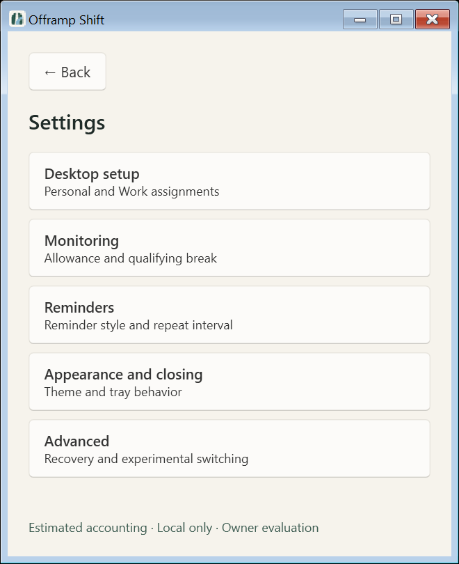
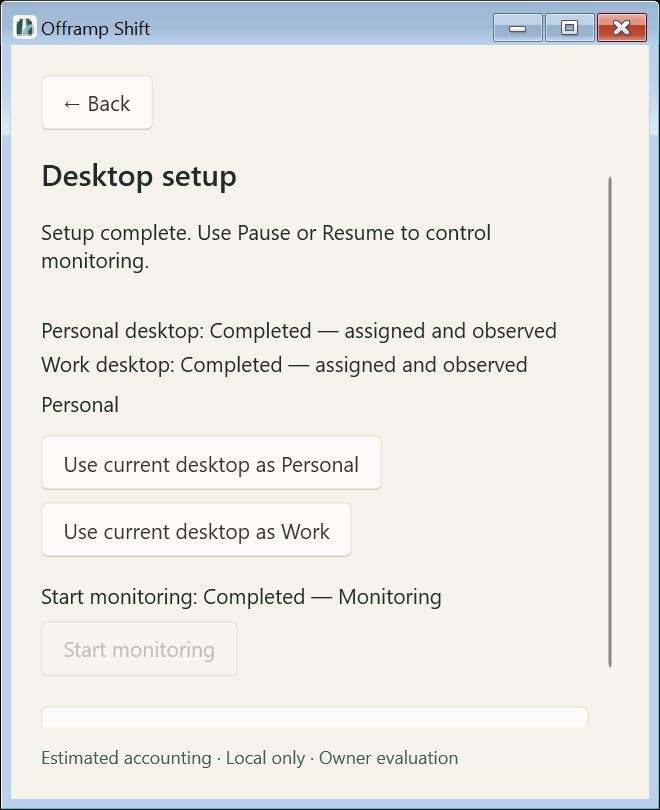
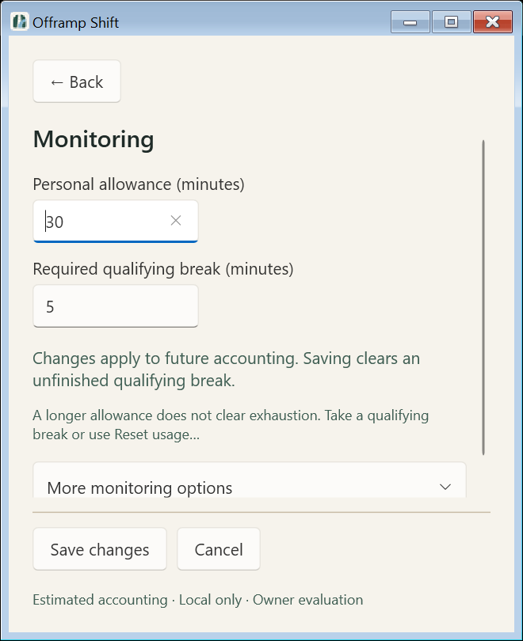
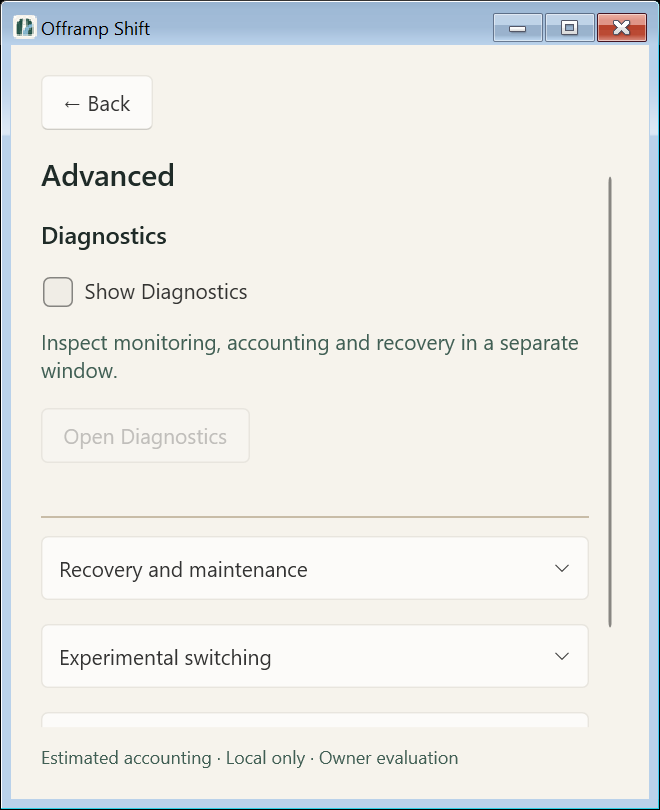
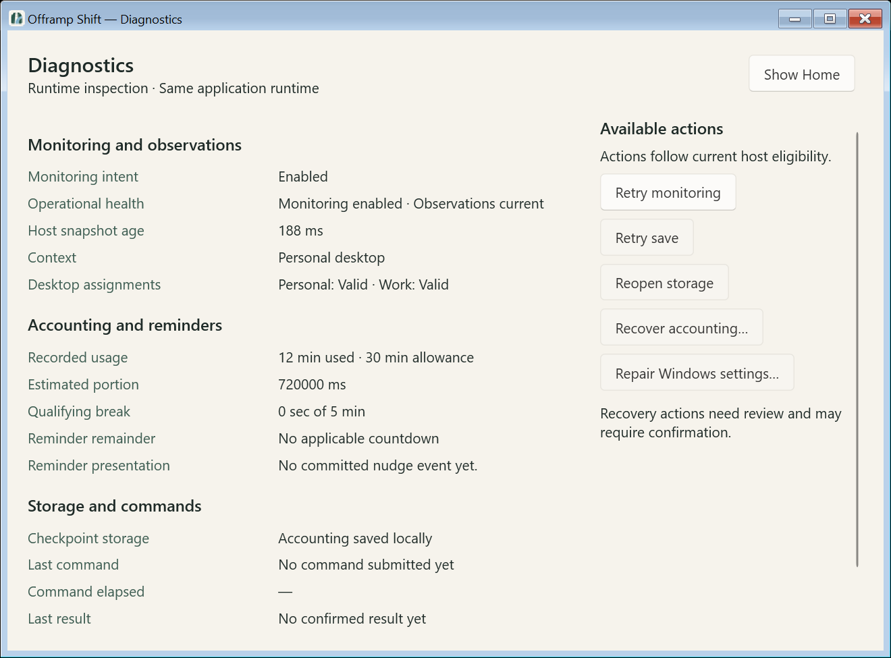
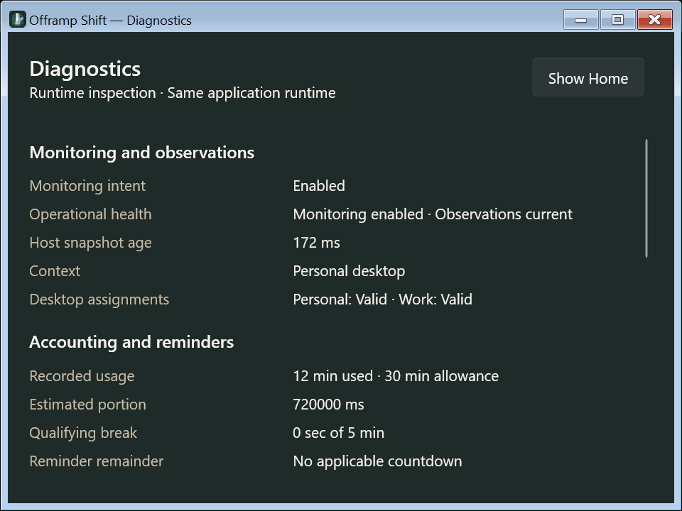

# PR B — Settings and optional Diagnostics

## Baseline and boundaries

The owner authorized implementation, a feature branch, commits, push and a review
PR on October 22, 2026. PR #21 was verified merged before creating
`codex/settings-diagnostics-redesign` from fetched `origin/main`
**3bedd976e8fac52c99796b4a4f68fd4fb7108b90**. The only pre-existing untracked
content was the owner's `.codex-remote-attachments/`, which is not committed.

The supplied final-design ZIP, standalone `DESIGN-HANDOFF.md`, detailed PR B
request, and PR A architecture/validation govern this work. The implementation
request approves the refinements which the older design-only handoff calls
proposed. The detailed request and PR A record provide the three-slice boundary;
no separate implementation-plan file was present in the supplied ZIP.

This slice changes the five Settings detail groups and adds optional Diagnostics.
Home, tray, Core accounting rules, estimator, providers, native switching,
allowlists, WindowsSettings v5, SQLite checkpoints and the interactive reminder
presentation transaction keep their established contracts. PR C reminder styling,
visibility issue #22 and Xbox compatibility issue #23 remain separate.

## Draft and command contract

`SettingsDrafts.cs` is a view-specific partial of MainWindow with five explicit
groups: durations, reminder style, repeat interval, appearance/closing, and
switching consent. It is not a reusable form framework. Each group retains its
confirmed baseline and editor fields. Snapshot refreshes update clean groups;
dirty fields and their selection survive unrelated and relevant changes. Relevant
changes display a conflict warning. Errors remain attached to their group.

Save validates the exact existing ranges/precision, focuses the first invalid
field and submits an existing command with expected values. A queued request is
not success. Controls prevent duplicate submission; Back, external Settings
navigation, close-to-tray and Exit wait for confirmation while a draft save is
pending. Failed/exceptional submissions retain the draft and error. Successful
completion clears only that submitted group's dirty baseline and reports Changes
saved. A later edit made during completion remains dirty.

Back offers Save changes / Discard changes / Keep editing. Save is disabled when
the corresponding host/storage gate or command coordinator prevents saving.
Each changed reminder group saves separately; a failure does not roll back an
already confirmed group. Cancel discards the current page's drafts and returns
to the overview. Originating overview rows regain focus; detail navigation targets
the first useful field. Alt+Left uses the same guard. Normal snapshot updates do
not navigate or reset focus.

Discard affects editor drafts only. It never cancels an already pending durable
checkpoint. Retry save retains its exact existing checkpoint command and epoch
behavior. The original first-close preference, close-to-tray/tray-failure behavior,
pending-checkpoint Exit confirmation and delayed cleanup path remain after the
draft-loss guard. Diagnostics is disposed only once Exit proceeds. Windows session
ending retains its existing best-effort stop behavior without blocking logout.

`ExpectedSettingsValues` compares only fields owned by the receiving command.
Durations do not conflict with repeat or preferences; style does not conflict with
appearance; combined appearance/close compares both fields. Switching compares its
consent and consent scope. Existing immediate commands can omit preconditions,
including first-close's preference-only patch. `ConfigurationConflict` is a
structured unsuccessful result, not a message parsed by the view.

Owner ordering is preserved: revoke unconsumed switching grant, invalidate reminder
mailbox, revoke applicable active presentation, check prerequisites and expected
values, then mutate/persist. Conflicts leave configuration/accounting unchanged
while retaining those safety invalidations. Controller queue rejection is unchanged.

## Diagnostics and preferences

Advanced retains recovery/maintenance and technical reminder status whether or
not Diagnostics is enabled. Show Diagnostics is immediate, separate UI preference
persistence; enabling it does not open a window. Open Diagnostics creates or
focuses one nonmodal instance. Closing it leaves monitoring and preference alone.
Disabling closes it only after successful persistence. Startup never reopens it.
Closing the companion removes its DashboardModel/CommandCoordinator handlers.

`ui-preferences.json` is app-owned, in the existing application data directory,
with exactly `Version: 1` and boolean `ShowDiagnostics`. Missing files default off
without writing. Oversized, malformed, duplicate/unknown-field, wrong-type and
future-version files are preserved, disable preference writes and explain the
failure. Saves write/flush a unique temporary sibling, then atomically replace
(or initially move) it. Failures retain the previous confirmed preference and
window state, and clean up the temporary file where access permits. External file
changes detected before saving are refused. No repair/migration, WindowsSettings
schema change or accounting write is part of this preference.

Diagnostics shares MainWindow's DashboardModel, CommittedPresentation and
CommandCoordinator. The existing application refresh updates it; it creates no
timer, provider, cache, controller, polling, event history, logging or telemetry.
Recorded usage, break and countdown qualifiers match Home/tray. Technical values
are selectable read-only native controls. Missing runtime fields are explicitly
unexposed. Host publication age is labeled separately from provider observation
age; no provider freshness timestamp is invented. Command elapsed measures waiting
only. Actions use current shared gates and existing confirmations/host commands.

## Automated evidence

Pinned .NET SDK **10.0.401**, warnings as errors. Application checks use isolated
`artifacts/prb-build` output to avoid interfering with an existing owner app.
Local logs and the unpacked design package stay ignored under `artifacts/prb-*`.
The first sandbox restore exited without compiler diagnostics; the successful
unrestricted isolated restore/build supplies the evidence. Development failures
are corrected before the final recorded results below.

| Required check | Result |
|---|---|
| `./run.ps1 test` | PASS — Core 82 / 40,598 assertions; Persistence 84 / 778; Host 300 / 3,039; WPF 96 / 195; zero failures |
| `./run.ps1 format` | PASS — warnings-as-errors build and verify-no-changes |
| `./spikes/VirtualDesktop/run.ps1 test` | PASS — fake policy/owned non-COM isolation |
| `./spikes/BrowserAttribution/run.ps1 test` | PASS — synthetic and transport evidence |
| `./spikes/WindowsObservation/run.ps1 test` | PASS — 41 tests / 10,300 assertions, zero failures |
| `./spikes/WindowsObservation/compatibility.ps1 test` | PASS — 16 synthetic/owned-process cases, zero failures |
| `./spikes/WindowsObservation/run.ps1 format` | PASS — warnings-as-errors build and verify-no-changes |

Host regressions cover each conflicting save, unrelated changes, storage failure,
exact checkpoint retry, switch grant revocation, active presentation revocation
and mailbox invalidation. WPF regressions cover dirty refresh/selection retention,
save failure/confirmation, pending navigation/close guard, explicit discard,
unavailable owner, separate reminder operations, pending checkpoint access, strict
UI preference persistence/corruption, one-window lifecycle, shared data/commands
and the actual WPF unsaved dialog's labeled choices and disabled Save behavior.
Existing reminder and switching tests remain required. These are synthetic
providers/presentation with real local SQLite and isolated owned process tests,
not live shell/accounting certification.

## Native WPF inspection and visual comparison

`--inspect-home-shell` now also shows/captures the actual Diagnostics HWND. It uses
synthetic immutable facts and resource-only WPF; no monitoring owner, providers,
user settings or switching are started. Native PrintWindow captures only the
harness-owned HWNDs, including representative nonclient chrome; DWM decoration
may differ. Current local environment: **Windows 26300.9711/x64**, connected
**144 DPI / 150%** and **96 DPI / 100%** displays. Registry UBR is read separately
because Environment.OSVersion reports the build without its update revision.

The capture mode uses test-only software rendering and waits for a compositor
frame after navigation/resize. A hardware-composited attempt returned blank print
surfaces, so those files are excluded from the evidence. A capture guard now
rejects blank WPF output rather than treating layout success as a usable image.
Production rendering is unchanged.

The harness covers starting/minimum/wide sizes, all Settings routes, actual
scrollbar clearance and overflow scrolling, Light/Dark and content-font layout
stress. Diagnostics stacks actions below details under 780 DIP. It also tests a
real WPF unsaved dialog using routed buttons, rather than physical user input.
No system display, text-size or theme preferences are changed.

Comparison against measured Settings/Advanced/Diagnostics sheets preserves the
compact dimensions, native controls, hierarchy, Quiet Road colors and progressive
disclosure. Native Fluent expander/checkbox styling replaces the drawings' stylized
rows/toggle. The first batched captures revealed empty feedback/title gaps and
inherited technical TextBox spacing; the correction batch removes those gaps and
condenses Diagnostics. Monitoring Save/Cancel occupy a separate layout row so
scrolling cannot cover them. Extra technical fields are disclosed below the three
primary groups; they stay selectable and reachable by scrolling. Long operational
and failure messages can require scrolling rather than shrinking text. Native
control dimensions and accessible scroll access take precedence over exact SVG
pixels. Canonical repository artwork is unchanged.

| Settings overview | Desktop setup |
|---|---|
|  |  |

| Monitoring | Advanced |
|---|---|
|  |  |

Representative captures use the 150% display. The full local final capture set,
including both displays and Light/Dark variants, is in
`artifacts/prb-captures-verified`. This is shown native WPF with synthetic state,
not live operational acceptance. The Impeccable mechanical detector returned `[]`;
its source rules do not establish XAML or WPF accessibility validation.

## Owner validation — NOT RUN by this record

Record tested SHA, exact build/architecture, privilege, monitor layout, display
and text scales for each result.

- Physical Tab/Shift+Tab, access keys, Alt+Left, focus restoration, Narrator field
  names/errors/live announcements and visible focus in Light/Dark/System and
  actual Windows contrast themes.
- Actual Windows 150%/200% text enlargement (distinct from font stress), display
  scales 125%/200%, mixed-DPI transitions and taskbar/work-area constraints.
- Live desktop consent/assignment via tray, distinct/missing desktop validation,
  Start and Home/tray/Diagnostics agreement during controlled owner evaluation.
- Live close-to-tray, first-close choices, tray Exit and shutdown with unsaved
  drafts, failed saves and pending checkpoints. The automated guard/dialog tests
  do not certify the complete live shutdown workflow.
- Diagnostics opt-in/restart/open/focus/close/disable with the real app and local
  access failure. Synthetic persistence/lifecycle tests do not use owner files.
- Native fault/recovery exercises only with separately reviewed disposable data;
  otherwise NOT RUN. No broad accounting campaign is repeated.

PR 5 Tests 8–12 remain deferred. Explorer recovery #8, reliability/accuracy #9,
reminder visibility #22 and Xbox compatibility #23 are unresolved. Automatic
switching and production browser attribution remain **NO-GO**. No sustained-use,
accessibility, recovery or accounting certification, new permissions, telemetry,
distribution or licensing decision is inferred.
