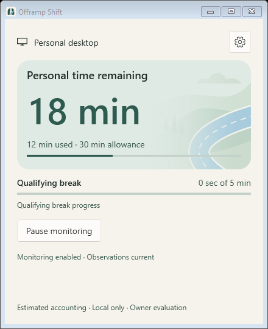
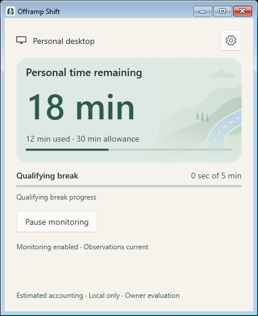

# PR C — Quiet Road visual polish

## Baseline and scope

PR #24 was verified merged on October 22, 2026 before fetching `origin/main`
and creating `codex/pr-c-visual-polish` from
**5b4f860781215b117c4cb05e9cb8f92c20e5f768**. The owner's detailed PR C brief,
subsequent light-mode priority, supplied final-design ZIP/handoff, canonical
`OFFRAMP_DESIGN.md` inside that ZIP, and PR A/B implementations informed this
refinement. Earlier design-only proposals are reference material; the PR C request
governs this implementation. Owner attachments stay untracked and uncommitted.

Home keeps its native 440 × 540 DIP starting window and 400 × 500 minimum.
The timer, arithmetic, usage progress, applicable reminder/extra-time remainder,
exhaustion explanation and recorded qualifiers now share a rounded sage hero.
Context, break progress, Pause/Resume and operational recovery stay outside it.
All values still come from the existing DashboardModel/CommittedPresentation.
Remaining seconds round up; accumulated seconds round down, unchanged from PR A.
Very long timer values wrap and scroll rather than clip or shrink the whole UI.

Light mode uses Warm Paper `#F6F3EC`, Moss `#2E5A4F`, and Fade's source Home
container `#DFE9E3`; dark Home uses its source container `#263F35`. The reminder
uses the shared Warm Paper / dark canvas and coordinated accent roles, without
scenic artwork. Home's frozen drawings are selected on theme changes; accounting
snapshots do not rebuild geometry or run a decorative clock.
Home now uses a Shift-specific wide landscape matching the owner's final approved
mockup, with a broad S-shaped road and layered hills on the right. This final
composition request supersedes the earlier exact-Fade-geometry requirement.
The timer area stays quiet through a stronger left veil;
opaque text backings protect every timer/qualifier/explanation from road detail,
including unusually long values and wrapped labels. A frozen rounded clip matches
the 20-DIP card corners. The background contributes no desired height, and uniform
scaling preserves its proportions as the card resizes. It is bottom/right aligned;
the complete wide scene fits without independently stretching either axis.
The scene has no input hit-testing, focus or automation peer. Contrast fallback
hides it and uses system brushes. The canonical logo assets remain unchanged.

The same small palette helper supplies Home, Settings/Diagnostics and reminder
roles. Settings retains its native utilitarian surfaces and existing drafts;
no new Settings implementation is included. The existing content-scroll template
moves to Application resources so reminder overflow also reserves a real scrollbar
column. Native Fluent control templates and focus behavior are retained.

## Reminder contract

The reminder is an action surface: small canonical icon, heading, full-width
primary Switch to Work when eligible, paired one/five-minute secondary actions,
and lightweight native Button navigation. Ordinary explanatory paragraphs and
the scenic panel are removed. How this works opens a dedicated view in the same
400 × 300 DIP window, with Back and scrollable sections. Returning restores
logical focus to How this works; entering focuses Back. Collapsed views leave
the keyboard/accessibility tree. Navigation invokes no host command.

The existing switch availability/consent gate still controls visibility and
pending state. Ordinary experimental-switching copy moves to help; actionable
availability reasons and polite command failure feedback stay in the action view.
A newly unavailable switch or failed operation while help is open returns to the
actions. Help retains the experimental one-attempt explanation, manual Win+Tab
alternative, eligible unlocked Personal use even without input, Work/locked
exclusions, dismissal deferral and Open Offramp Shift behavior. Help and long
operational messages scroll internally; placement clamps the same outer geometry
to the monitor work area without changing nonactivation or foreground safeguards.
Time-action labels wrap under enlarged text. System contrast uses system brushes
and suppresses the decorative family symbol; native control/focus templates remain.

Open Offramp Shift calls the application's existing `Open(false)` route through
the active NudgePresenter. It shows/restores/activates the same main window,
preserving its current page and any Settings draft. It leaves the authorized
reminder HWND open: closing it would invoke the existing durable one-minute
deferral. Navigation itself submits no host command, extends no time, switches
no desktop, creates no application/controller/window owner, and replays no
reminder. The navigation callback is ignored after automatic closure.

Authorization, foreground checks, nonactivating preparation, expiry, durable
deferral, X/Escape/Alt+F4 behavior, add-time persistence, indeterminate switching,
and automatic context-invalidated closure keep their existing paths. This does
not address issue #22 through forced focus or topmost windows. No adaptive inline
reminder, Core/accounting change, provider/allowlist change, retry, telemetry,
permission, schema, licensing or distribution decision is included.

## Automated evidence

Pinned .NET SDK **10.0.401**, warnings as errors. Application checks use
`UseArtifactsOutput=true` and `ArtifactsPath=G:\Projects\offramp-shift\artifacts\prc-build`
with the unchanged repository scripts. A default-output attempt encountered files
locked by the running owner app; that app was not stopped or replaced. A sandboxed
attempt also failed without compiler diagnostics. Only the isolated final results
below count as passing evidence.

| Required check | Result |
|---|---|
| `./run.ps1 test` | PASS — Core 82 / 40,598 assertions; Persistence 84 / 778; Host 300 / 3,039; WPF 117 / 195; zero failures |
| `./run.ps1 format` | PASS — warnings-as-errors builds and verify-no-changes |
| `./spikes/VirtualDesktop/run.ps1 test` | PASS — fake policy and owned non-COM worker isolation |
| `./spikes/BrowserAttribution/run.ps1 test` | PASS — synthetic and process/transport evidence |
| `./spikes/WindowsObservation/run.ps1 test` | PASS — 41 tests, 10,300 assertions, zero failures |
| `./spikes/WindowsObservation/compatibility.ps1 test` | PASS — 16 synthetic/owned-process cases |
| `./spikes/WindowsObservation/run.ps1 format` | PASS — warnings-as-errors build and verify-no-changes |

Existing regressions cover normal/exhausted/extra-time/paused/stale/unavailable/
zero-overage-latched projections, rounding and epochs, reminder authorization,
closing, failures, pending time and switch outcomes. New regressions cover shared
light/dark/system-brush roles, scene exclusion, solid text contrast (4.5:1 on canvas
and hero), switch visibility, callback wiring, navigation during pending extra
time, retained reminder identity and no navigation command/replay. These are
synthetic tests, not live accounting or shell validation.

The initial PR C revision `852a7f87124d3325bb531da556396baadf66e3f2` passed 101
focused WPF tests. The enlargement follow-up adds a layout regression for full-card
background sizing, height independence at several widths, frozen rounded clipping,
text backings and the unchanged 48 × 60 DIP reminder scene. Presentation helper
assertions throw directly rather than incrementing Program's legacy assertion counter.

The direct-source port added two pinned artwork-contract tests. The final approved
composition pass replaces those exact-path requirements with checks for a frozen
broad road ribbon, separate shoulder/fill/lane geometry, subtle dash lengths,
readability veils and a proportional wide viewport. The Home paper role still
participates in solid text-contrast checks. Earlier source-fidelity results are
historical evidence, not claims about the final Shift-specific paths.

The initial PR C Impeccable mechanical detector returned `[]` on XAML; its source
coverage does not establish WPF layout or accessibility correctness.

## Native WPF layout evidence

**Automated native capture PASS: Windows 26300.9711/x64**, with shown harness-owned
WPF HWNDs and immutable synthetic state. The harness creates no monitoring owner,
user settings, providers or switching. PrintWindow captures only its own windows;
software rendering is enabled in capture mode only. Native Windows chrome remains
Windows-owned. Both connected displays were measured: **144 DPI / 150%** and
**96 DPI / 100%**. This is actual WPF layout, not a browser mockup or manual
operational/accessibility acceptance.

The pass covers light/dark normal, subminute, exhausted, extension, paused, stale,
unavailable, Work, latched and command-pending Home; initial/minimum/wide sizes;
long timer values; Settings/Diagnostics; reminder defaults and constrained errors;
and 1.5×/2× text-size layout stress. The latter changes WPF text properties only
and is **not** evidence of changing Windows' text-size setting. A system-brush
simulation checks scene removal; it is **not** an actual Windows contrast theme.
Common healthy states have no vertical scroll range at the starting size.
Overflow retains reachable actions and a separate scrollbar column.

During development, an extension-to-paused transition exposed a transient Auto
scrollbar with the prior extent. The inspection now explicitly remeasures the
final extent before clearance assertions. Reduced hero vertical padding also
keeps the common states compact. Production receives no polling/layout retry.

Compared with the supplied Fade light reference and the original PR C captures,
Home has a continuous landscape instead of a 68 × 84 DIP image beside the timer.
The final composition pass uses the approved generated mockup for the broad
road sweep, hill depth and scene placement; Fade remains the palette/mood reference.
It supersedes the intermediate exact source port described below. The dominant
60-DIP timer, normal-state hero height and window dimensions remain unchanged.
The reminder, Settings, their content and all transactions are unchanged by these
artwork follow-ups. Actual contrast-theme and screen-reader checks remain NOT RUN.

### Enlargement follow-up on PR #25

The owner requested this composition-only update on `codex/pr-c-visual-polish`.
Changes are limited to QuietRoad's static Home composition, the Home hero layering,
focused regression coverage and this validation/screenshot record. The original
reminder drawing, fade, dimensions and behavior remain intact. No new PR is created.

The first enlarged native pass completed on both displays with 101 existing tests
and 62 captures per display. It showed continuous hills, a recognizable road,
clear text, rounded clipping, unchanged common-state height and scrollable degraded
states. No additional visual changes followed that review. The final pass passed
**102 WPF tests**, including the new composition regression, and again produced
**62 captures per display** at 144 and 96 DPI. All seven repository checks passed
for this follow-up; results are in the table above. At 150%, normal Home content
height remains **329.72 DIP** before and after enlargement; exhausted/extra-time
content remains **369.62 DIP** within a **386.71 DIP** viewport. The enlarged
scene creates no additional scroll range in common healthy states.

### Historical direct Fade source port — October 23, 2026

This section records revision `1d2b46624a867cf85a9ef2b29e1e26010ccb97fd`.
Its exact-path constraint was subsequently superseded by the owner's final mockup
composition request. The final implementation is described in the next section.

Source authority: [`QuietRoadLandscape.kt`](https://github.com/NDePetris/phone-fade/blob/e873280d492c4aa8e02c0fbaae56e887ecf16931/app/src/main/java/app/ndplabs/phonefade/QuietRoadLandscape.kt)
at commit **e873280d492c4aa8e02c0fbaae56e887ecf16931**, Git blob
`d22739693dcd8eba77504e56c49f40dfd9b34a56`. Container colors were verified in
[`FadeTheme.kt` at the same commit](https://github.com/NDePetris/phone-fade/blob/e873280d492c4aa8e02c0fbaae56e887ecf16931/app/src/main/java/app/ndplabs/phonefade/FadeTheme.kt).
Both were read through GitHub at that exact ref. There is no runtime Android
repository access. That revision's `FadeLandscape.cs` recorded the repository/file/commit and
the original **360 × 280** coordinate system beside the port.

The prior Shift implementation used a 400 × 180 approximation, a thick stroked
curve, different silhouette coordinates and a single opacity mask. The new port
preserves the following source data and drawing order:

1. Cloud silhouette; distant, middle and near hills, with every original control
   point and close operation.
2. The closed road ribbon `M285,330 C248,219 260,181 368,134 L368,172
   C290,207 302,241 347,330 Z`, first stroked with a 5-unit shoulder, then filled.
3. Centerline `M316,330 C268,218 282,196 365,153`, 2.5-unit stroke, rounded
   dash/end caps. Compose's absolute `[10,12]` dash pattern becomes WPF's
   width-relative `[4,4.8]`, offset zero.
4. Three separate triangular trees, at `(238,164,h22)`, `(251,168,h30)` and
   `(264,170,h24)`, each eight units wide.
5. Horizontal paper veil, then vertical paper fade, drawn after the clipped scene
   and below every foreground label, value, progress bar and control.

| Source role | Light | Dark |
|---|---|---|
| Distant / cloud | `#D0DFD2` | `#355448` |
| Middle hill | `#B8CCBF` | `#3C5F53` |
| Near hill | `#D3DECC` | `#304A40` |
| Road ribbon | `#B4D4E2` | `#406679` |
| Shoulder / centerline | `#F6F3EC` | `#93B7C7` |
| Trees | `#8FAE9D` | `#638675` |
| Paper container / veils | `#DFE9E3` | `#263F35` |

The horizontal gradient retains stops **0% opaque, 48% opaque, 82% at 30%
opacity, 100% at 8% opacity**. WPF's 8-bit alpha rounds those last two values to
77 and 20. The vertical gradient remains **0% transparent, 60% transparent,
100% opaque paper**. An initial dark WPF capture showed a pale interpolation band
when using WPF's named Transparent (white RGB). The final brush uses zero-alpha
paper RGB for its transparent stops, preserving transparent-to-paper compositing
without that fringe. Gradient positions, opacity targets and order are unchanged.
No generic substitute opacity mask is applied to Home.

**Windows viewport adaptation:** for card size `(W,H)`, uniformly scale the
original plane by `s = min(W/480, H/280)` and translate by
`(W - 360s, H - 280s)`. At the normal card this occupies about 60% of the width.
The complete plane fits; the source's own 360 × 280 clip trims only geometry
outside it, including the ribbon's y=330 closure. The existing 20-DIP rounded card
clip applies afterward. The source gradient stops operate across the actual card
viewport, as Compose draws its veils outside the geometry's scale transform.
Tall/long-text states keep the scene compact and bottom aligned. This is the only
geometric adaptation; paths are neither redrawn nor stretched independently.

MainWindow's only change in this follow-up is binding existing hero surfaces and
text backings to the source Home-paper role. Foreground coordinates, margins,
font sizes, window sizing, projections, commands and reminder source are unchanged.
The scene and all brushes are frozen and locally packaged. No clock, animation,
provider, network access, new permission or dependency was added.

The source-contract tests establish exact coordinate/color data, not equality
between Compose and WPF rasterization. **Pixel-perfect equality is not claimed.**
Native captures are shown WPF with synthetic committed state; actual owner/device
acceptance, Narrator and Windows contrast themes remain NOT RUN.

**Final direct-port results:** all seven required checks passed with the pinned
SDK and isolated application output. The native inspection also passed **104
WPF tests** and captured **62 images per monitor**, on Windows **26300.9711/x64**
at **144 DPI / 150%** and **96 DPI / 100%**. Light normal, exhausted, extension,
dark, minimum, stale and unavailable captures were replaced after comparison
with the supplied Fade references, the pinned source paths and the preceding
Shift captures. The final dark capture confirms the pale gradient band is gone.
No layout, scroll-clearance, common-state fit or synthetic contrast-role regression
was found. Tests and captures remain separate from manual owner acceptance.

### Final Home composition — October 23, 2026

The owner supplied the approved generated mockup after the final composition brief.
Its original attachment is `codex-clipboard-bbe2ed1d-3cd0-4a06-aab9-8bc7b3aa38c4.png`,
SHA-256 `DC9D35586ACD6EDCBFE1FA287D240F2BD5DE7CF2E7E6CA116F52A96CF6D7F963`.
An unchanged local reference remains ignored at
`artifacts/prc-composition-approved-mockup.png`; it is not a production asset.

`HomeLandscape.cs` replaces the exact source-port class with a **400 × 184**
Shift-specific vector composition. A broad, tapered S-bend enters from the lower
right, turns inward through the middle-right and returns toward the horizon.
Four hill layers, a soft cloud and small conifer clusters supply scenic depth.
The colors retain Fade's subdued greens and sky blue. The shoulder is 2 logical
units; the centerline is 1.25 units with round caps and absolute 8/11-unit dashes.
The outer curve stays just inside the right edge rather than cutting off the bend.

The left veil stays opaque through 55% of the card, then falls to 18% opacity at
74%, 5% at 86% and 2% at the right edge. This keeps ordinary timer/usage backings
from showing a hard edge while exposing the larger sweep. A foreground fade starts
at 72% of card height and reaches opaque paper at the bottom, keeping the usage
progress strip visually clear. Existing text backings still protect verbose states.
Transparent stops retain paper RGB to avoid the previously identified dark fringe.

The viewport uses `s = min(W/400, H/184)` with offset
`(W - 400s, H - 184s)`. It scales uniformly and adds no desired height.
The scene clip is 400 × 184, followed by the existing rounded card clip. The entire
road bend remains visible in normal/minimum layouts; only the foreground ribbon's
off-plane continuation is trimmed. Wider/taller states preserve proportions.

**Scope check:** MainWindow.xaml, hero dimensions, timer/progress placement, section
order, reminder rendering/content/transactions, Settings, Diagnostics, accounting,
commands, navigation, switching and recovery were not changed in this pass.
Only Home artwork/resources, their focused regressions and this evidence record
changed. The former source-contract tests were replaced because their geometry
requirement is explicitly no longer applicable; operational/layout/theme/focus
regressions remain in place. No dependency, animation or decorative timer was added.

The initial native comparison showed the intended broader sweep and hill depth,
but exposed an edge at the timer backing. The final batch strengthened the left
veil, softened the cloud and inset the outer curve. Bottom alignment also keeps
the scene clip at the card edge in verbose states, avoiding an internal cutoff.
Native WPF cannot reproduce
every organic detail/texture of a generated image; the deliberate result uses
simple, restrained vectors. Pixel-perfect mockup equality is not claimed.

**Final results:** all seven established checks passed. The full application run
passed Core 82 / 40,598 assertions, Persistence 84 / 778, Host 300 / 3,039 and
WPF 104 / 195, with zero failures. After the final bottom-alignment adjustment,
the focused WPF rebuild, verify-no-changes format check and **104 tests** also
passed. The final native matrix captured **62 images per monitor** on Windows
**26300.9711/x64**, at **144 DPI / 150%** and **96 DPI / 100%**. Normal, exhausted,
extra-time, dark, minimum, stale and unavailable captures were updated from that
matrix. The broad road sweep and layered depth are visibly closer to the approved
mockup than the prior source port. Text remains readable, the normal hero has the
same height, healthy states fit and degraded/long states retain scrolling.

Physical keyboard, Narrator, actual Windows contrast themes and Windows text enlargement remain
**NOT RUN**, and all previous operational safety gates/deferrals remain in force.

### Captures

The following are 150% captures unless labeled 100%:

| Home normal | Home exhausted |
|---|---|
|  |  |

| Extra Personal time | Dark Home |
|---|---|
|  |  |

| Light reminder | Dark reminder |
|---|---|
|  |  |

| Stale Home | Minimum Home |
|---|---|
|  |  |

| Home at 100% | Reminder at 100% |
|---|---|
|  |  |

[Previous PR C Home at 100%](images/pr-c/light-normal-before-enlargement-100.png)
preserves the original small-scene capture for direct comparison.

| Enlarged approximation before the source port (`8432070`) | Current final composition |
|---|---|
|  |  |

| Exact source port before the final pass (`1d2b466`) | Approved-mockup composition |
|---|---|
|  |  |

[Unavailable observations with retained visible values](images/pr-c/light-unavailable.png)
is a fresh synthetic host snapshot with unavailable observations; it is distinct
from the stale-publication capture above.

[Constrained reminder with synthetic errors](images/pr-c/light-reminder-constrained.png)
shows the scrollable overflow treatment. The full local capture matrix and layout
logs for the enlargement remain ignored under `artifacts/prc-large-final/`;
the direct-port matrix is under `artifacts/prc-port-final/`; the final composition
verified matrix is under `artifacts/prc-composition-verified/`.

## Focused owner checklist — NOT RUN

- [ ] Compare the light Home/reminder against Fade; confirm timer hierarchy and
      artwork restraint at starting/minimum size with real Personal/Work context.
- [ ] Use keyboard, focus, Narrator and actual Windows contrast themes; inspect
      availability announcements, disclosure, errors and scroll access.
- [ ] Verify Windows text enlargement, additional display scales and mixed-DPI
      transitions. Automated per-display captures do not certify those settings.
- [ ] With a naturally authorized live reminder, Open Offramp Shift should restore
      the existing window, retain drafts and leave the reminder open with no extra
      time or desktop switch. Then verify ordinary dismissal/add-time semantics.
- [ ] Check authorized switching availability and uncertainty only through the
      existing deliberate supported-build owner procedure. No automatic switching.

PR 5 Tests 8–12 remain deferred / NOT RUN. Issues #8, #9, #22 and #23 remain
unresolved. Automatic switching and production browser attribution remain
**NO-GO**. No unattended-use, recovery, sustained accuracy or accessibility
certification follows from these tests or screenshots. No merge/release is authorized.

## Minimal reminder redesign — October 23, 2026

The owner's latest reminder brief and action/help mockup supersede the earlier
small scenic reminder treatment. The approved Home implementation and artwork
are unchanged in this follow-up. Settings and Diagnostics also remain unchanged.
A future consistent lightweight disclosure treatment across Settings/Diagnostics
is recorded as **deferred design feedback**, not implementation scope.

All seven required repository checks passed (table above). WPF now has **117
passing tests**, including minimal content, routing without commands, logical
focus restoration, exact Add 1/5 and close/Escape durations in both views, pending
and failed actions, availability changes, automatic invalidation while help is
open, and system-brush fallback. Existing presenter transaction, authorization,
expiry, native-close and switching outcome regressions remain passing. The 195
central assertions do not count helper-local assertions.

Native shown-HWND evidence: Windows **26300.9711/x64**, connected displays at
**144 DPI / 150%** and **96 DPI / 100%**, pinned SDK 10.0.401, software rendering
in the opt-in test harness only. The final matrix contains **76 captures per
display**, including 18 reminder captures (light/dark action, unavailable, help,
help end, pending, failed-save, constrained action/end and constrained help).
The harness asserts stable help bounds and position, normal action fit, scroll
access and reserved scrollbar clearance. It uses synthetic callbacks, no host,
owner storage, monitoring, providers, actual switching or global input.
Local matrix and logs: `artifacts/prc-reminder-verified/` and
`artifacts/reminder-native-verified.log` (ignored).

Compared directly with the supplied mockup, the default removes the scenic panel
and ordinary paragraphs, gives Switch to Work the full action width, pairs Add
1/5 below it, and separates subdued navigation. Help has Back and short sections
within identical geometry, rather than an expanding disclosure. Native Fluent
chrome is retained. Long errors and enlarged/constrained layouts deliberately
scroll; screenshot pairs include the end position to show recovery/actions can
be reached. Text enlargement here is a synthetic WPF font-size stress case,
not actual Windows text-setting acceptance.

| Reminder state | 100% | 150% |
|---|---|---|
| Available | [Capture](images/pr-c/light-reminder-100.png) | [Capture](images/pr-c/light-reminder.png) |
| Unavailable | [Capture](images/pr-c/light-reminder-unavailable-100.png) | [Capture](images/pr-c/light-reminder-unavailable.png) |
| Help | [Capture](images/pr-c/light-reminder-help-100.png) | [Capture](images/pr-c/light-reminder-help.png) |
| Help end | [Capture](images/pr-c/light-reminder-help-end-100.png) | [Capture](images/pr-c/light-reminder-help-end.png) |
| Pending | [Capture](images/pr-c/light-reminder-pending-100.png) | [Capture](images/pr-c/light-reminder-pending.png) |
| Failed save | [Capture](images/pr-c/light-reminder-error-100.png) | [Capture](images/pr-c/light-reminder-error.png) |
| Dark | [Capture](images/pr-c/dark-reminder-100.png) | [Capture](images/pr-c/dark-reminder.png) |
| Enlarged / constrained | [Capture](images/pr-c/light-reminder-constrained-100.png) | [Capture](images/pr-c/light-reminder-constrained.png) |
| Constrained end | [Capture](images/pr-c/light-reminder-constrained-end-100.png) | [Capture](images/pr-c/light-reminder-constrained-end.png) |
| Constrained help | [Capture](images/pr-c/light-reminder-constrained-help-100.png) | [Capture](images/pr-c/light-reminder-constrained-help.png) |

The earlier [scenic reminder](images/pr-c/light-reminder-before-minimal-100.png)
is preserved for comparison. Physical keyboard/Tab order/focus, Narrator, actual
Windows contrast themes and text settings, mixed-DPI transitions and a naturally
authorized owner reminder remain **NOT RUN**. Those owner checks, PR 5 deferrals,
issue #22 and all existing NO-GO gates are unchanged. Native synthetic captures
and system-brush regressions are not live owner/accessibility acceptance.
