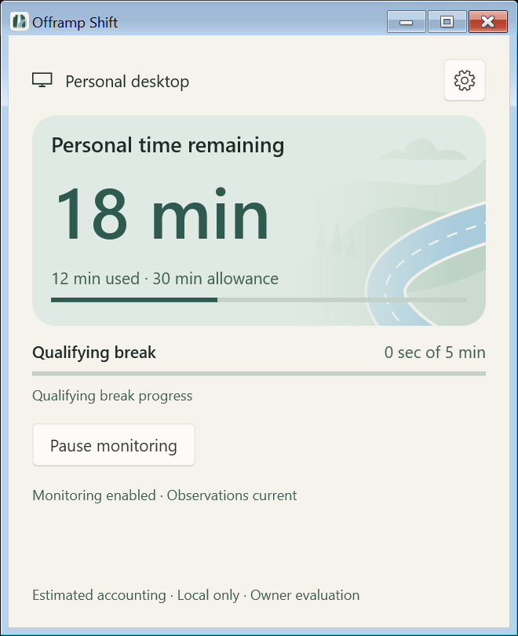
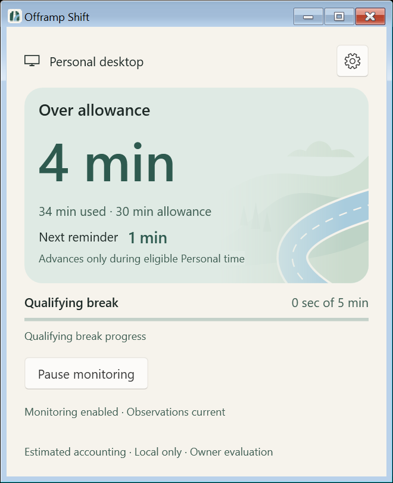
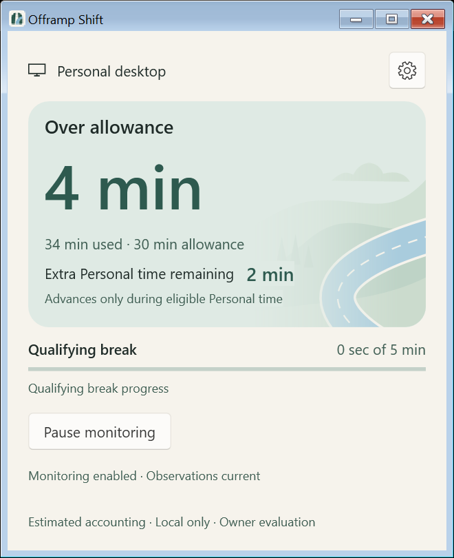
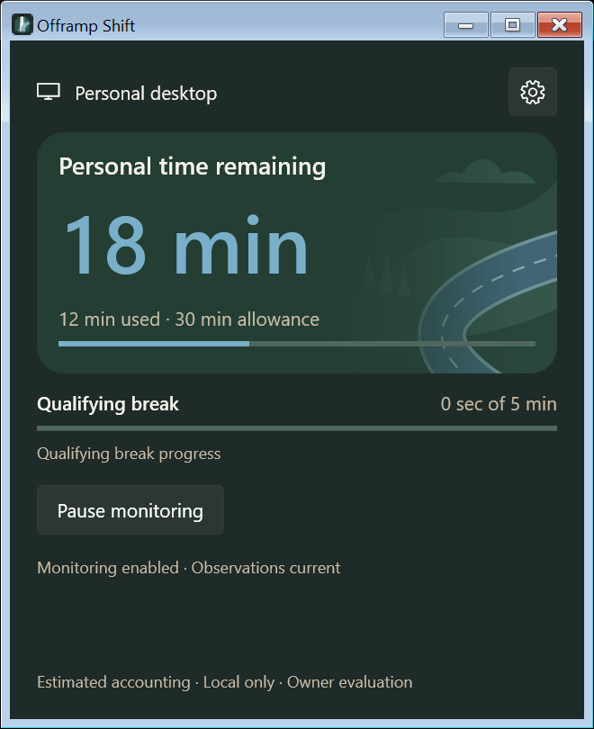
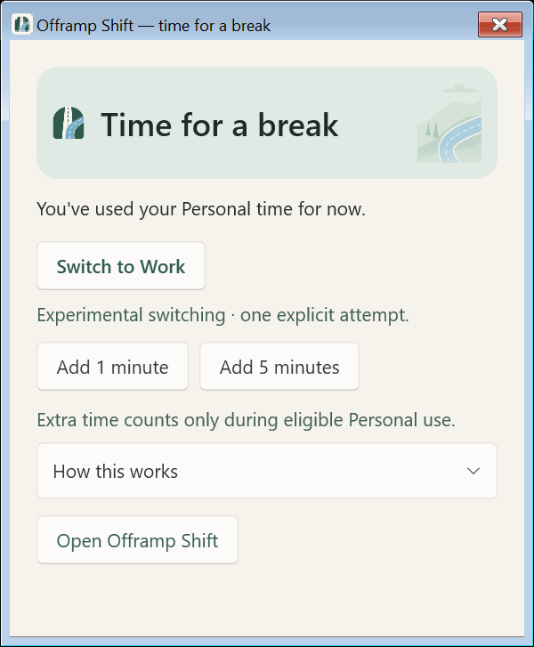
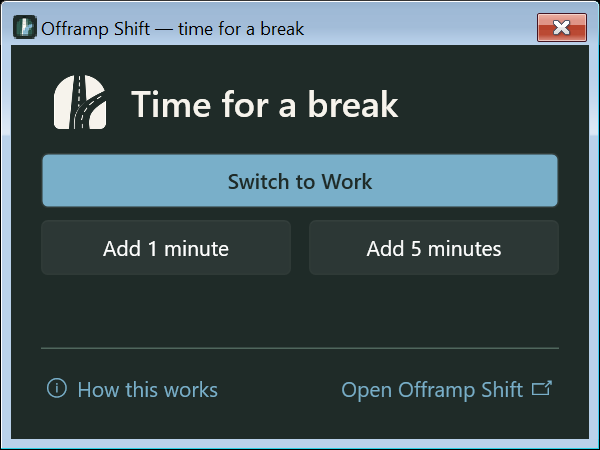
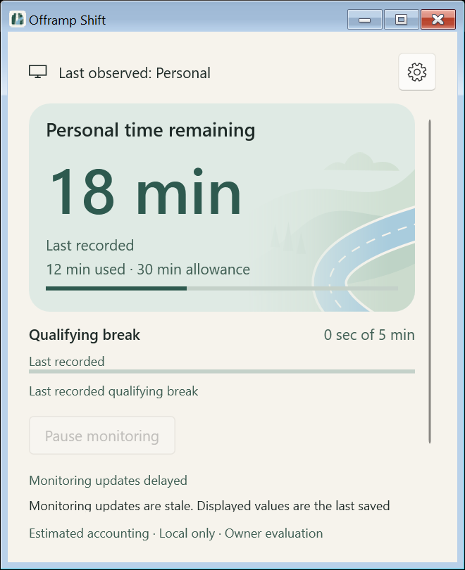
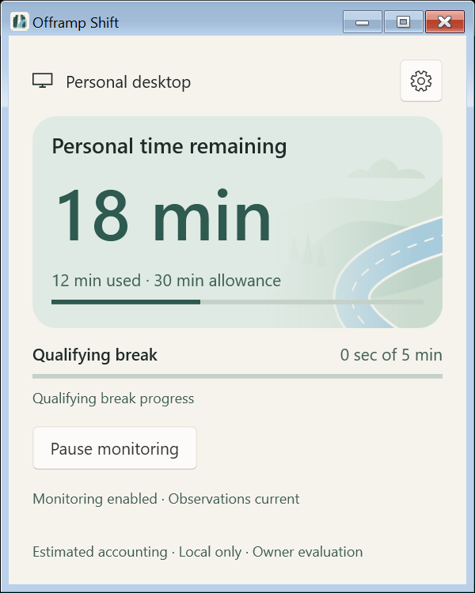
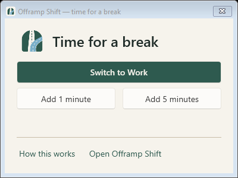

# PR C — Quiet Road visual polish

## Baseline and scope

PR #24 was verified merged on October 22, 2026 before fetching `origin/main`
and creating `codex/pr-c-visual-polish` from
**5b4f860781215b117c4cb05e9cb8f92c20e5f768**. The owner's detailed PR C brief,
subsequent light-mode priority, supplied final-design ZIP/handoff, canonical
`OFFRAMP_DESIGN.md` inside that ZIP, and PR A/B implementations informed this
refinement. Earlier design-only proposals are reference material; the PR C request
governs this implementation. Owner attachments stay untracked and uncommitted.

Home keeps its native 440 × 540 DIP starting window and 400 × 500 minimum.
The timer, arithmetic, usage progress, applicable reminder/extra-time remainder,
exhaustion explanation and recorded qualifiers now share a rounded sage hero.
Context, break progress, Pause/Resume and operational recovery stay outside it.
All values still come from the existing DashboardModel/CommittedPresentation.
Remaining seconds round up; accumulated seconds round down, unchanged from PR A.
Very long timer values wrap and scroll rather than clip or shrink the whole UI.

Light mode uses Warm Paper `#F6F3EC`, sage `#DFEAE4`, Moss `#2E5A4F`, and a
muted Sky-derived roadway. Dark mode uses Pine and a darker moss hero.
QuietRoad uses shared frozen light/dark WPF drawings and fade masks, with distinct
Home-background and small-reminder compositions. Theme changes select a drawing;
snapshots do not rebuild it or run a decorative clock. Home's scene is a background
layer covering the card; the reminder keeps its original small illustration.
Home hills extend across roughly the right 60–65%, fading toward the text-heavy
left. The recognizable road curves in from the lower-right and stays on the right;
opaque text backings protect every timer/qualifier/explanation from road detail,
including unusually long values and wrapped labels. A frozen rounded clip matches
the 20-DIP card corners. The background contributes no desired height, and uniform
width scaling preserves its proportions as the card resizes. It is bottom anchored;
wide/shallow layouts can crop the upper scenery instead of stretching it.
The scene has no input hit-testing, focus or automation peer. Contrast fallback
hides it and uses system brushes. The canonical logo assets remain unchanged.

The same small palette helper supplies Home, Settings/Diagnostics and reminder
roles. Settings retains its native utilitarian surfaces and existing drafts;
no new Settings implementation is included. The existing content-scroll template
moves to Application resources so reminder overflow also reserves a real scrollbar
column. Native Fluent control templates and focus behavior are retained.

## Reminder contract

The reminder uses the same paper/sage/road vocabulary, concise default copy,
existing one/five-minute actions, and a native How this works disclosure. The
switch action is visible only when the existing availability gate permits it;
it stays disabled during pending operations. Experimental-switch warnings,
unavailability reasons, and command errors remain visible outside the disclosure.
Win+Tab fallback and existing dismissal/eligibility explanations are in it.
The visible availability warning remains the polite live region.

Open Offramp Shift calls the application's existing `Open(false)` route through
the active NudgePresenter. It shows/restores/activates the same main window,
preserving its current page and any Settings draft. It leaves the authorized
reminder HWND open: closing it would invoke the existing durable one-minute
deferral. Navigation itself submits no host command, extends no time, switches
no desktop, creates no application/controller/window owner, and replays no
reminder. The navigation callback is ignored after automatic closure.

Authorization, foreground checks, nonactivating preparation, expiry, durable
deferral, X/Escape/Alt+F4 behavior, add-time persistence, indeterminate switching,
and automatic context-invalidated closure keep their existing paths. This does
not address issue #22 through forced focus or topmost windows. No adaptive inline
reminder, Core/accounting change, provider/allowlist change, retry, telemetry,
permission, schema, licensing or distribution decision is included.

## Automated evidence

Pinned .NET SDK **10.0.401**, warnings as errors. Application checks use
`UseArtifactsOutput=true` and `ArtifactsPath=G:\Projects\offramp-shift\artifacts\prc-build`
with the unchanged repository scripts. A default-output attempt encountered files
locked by the running owner app; that app was not stopped or replaced. A sandboxed
attempt also failed without compiler diagnostics. Only the isolated final results
below count as passing evidence.

| Required check | Result |
|---|---|
| `./run.ps1 test` | PASS — Core 82 / 40,598 assertions; Persistence 84 / 778; Host 300 / 3,039; WPF 102 / 195; zero failures |
| `./run.ps1 format` | PASS — warnings-as-errors builds and verify-no-changes |
| `./spikes/VirtualDesktop/run.ps1 test` | PASS — fake policy and owned non-COM worker isolation |
| `./spikes/BrowserAttribution/run.ps1 test` | PASS — synthetic and process/transport evidence |
| `./spikes/WindowsObservation/run.ps1 test` | PASS — 41 tests, 10,300 assertions, zero failures |
| `./spikes/WindowsObservation/compatibility.ps1 test` | PASS — 16 synthetic/owned-process cases |
| `./spikes/WindowsObservation/run.ps1 format` | PASS — warnings-as-errors build and verify-no-changes |

Existing regressions cover normal/exhausted/extra-time/paused/stale/unavailable/
zero-overage-latched projections, rounding and epochs, reminder authorization,
closing, failures, pending time and switch outcomes. New regressions cover shared
light/dark/system-brush roles, scene exclusion, solid text contrast (4.5:1 on canvas
and hero), switch visibility, callback wiring, navigation during pending extra
time, retained reminder identity and no navigation command/replay. These are
synthetic tests, not live accounting or shell validation.

The initial PR C revision `852a7f87124d3325bb531da556396baadf66e3f2` passed 101
focused WPF tests. The enlargement follow-up adds a layout regression for full-card
background sizing, height independence at several widths, frozen rounded clipping,
text backings and the unchanged 48 × 60 DIP reminder scene. Presentation helper
assertions throw directly rather than incrementing Program's legacy assertion counter.

The initial PR C Impeccable mechanical detector returned `[]` on XAML; its source
coverage does not establish WPF layout or accessibility correctness.

## Native WPF layout evidence

**Automated native capture PASS: Windows 26300.9711/x64**, with shown harness-owned
WPF HWNDs and immutable synthetic state. The harness creates no monitoring owner,
user settings, providers or switching. PrintWindow captures only its own windows;
software rendering is enabled in capture mode only. Native Windows chrome remains
Windows-owned. Both connected displays were measured: **144 DPI / 150%** and
**96 DPI / 100%**. This is actual WPF layout, not a browser mockup or manual
operational/accessibility acceptance.

The pass covers light/dark normal, subminute, exhausted, extension, paused, stale,
unavailable, Work, latched and command-pending Home; initial/minimum/wide sizes;
long timer values; Settings/Diagnostics; reminder defaults and constrained errors;
and 1.5×/2× text-size layout stress. The latter changes WPF text properties only
and is **not** evidence of changing Windows' text-size setting. A system-brush
simulation checks scene removal; it is **not** an actual Windows contrast theme.
Common healthy states have no vertical scroll range at the starting size.
Overflow retains reachable actions and a separate scrollbar column.

During development, an extension-to-paused transition exposed a transient Auto
scrollbar with the prior extent. The inspection now explicitly remeasures the
final extent before clearance assertions. Reduced hero vertical padding also
keeps the common states compact. Production receives no polling/layout retry.

Compared with the supplied Fade light reference and the original PR C captures,
Home now has a continuous landscape and a substantially larger winding road,
instead of a 68 × 84 DIP image beside the timer. Paper/sage/Moss roles and the
dominant 60-DIP timer remain. Normal-state hero height and window dimensions are
unchanged. The reminder, Settings, their content and all transactions are unchanged
by this follow-up. Actual contrast-theme and screen-reader checks remain NOT RUN.

### Enlargement follow-up on PR #25

The owner requested this composition-only update on `codex/pr-c-visual-polish`.
Changes are limited to QuietRoad's static Home composition, the Home hero layering,
focused regression coverage and this validation/screenshot record. The original
reminder drawing, fade, dimensions and behavior remain intact. No new PR is created.

The first enlarged native pass completed on both displays with 101 existing tests
and 62 captures per display. It showed continuous hills, a recognizable road,
clear text, rounded clipping, unchanged common-state height and scrollable degraded
states. No additional visual changes followed that review. The final pass passed
**102 WPF tests**, including the new composition regression, and again produced
**62 captures per display** at 144 and 96 DPI. All seven repository checks passed
for this follow-up; results are in the table above. At 150%, normal Home content
height remains **329.72 DIP** before and after enlargement; exhausted/extra-time
content remains **369.62 DIP** within a **386.71 DIP** viewport. The enlarged
scene creates no additional scroll range in common healthy states.

### Captures

The following are 150% captures unless labeled 100%:

| Home normal | Home exhausted |
|---|---|
|  |  |

| Extra Personal time | Dark Home |
|---|---|
|  |  |

| Light reminder | Dark reminder |
|---|---|
|  |  |

| Stale Home | Minimum Home |
|---|---|
|  |  |

| Home at 100% | Reminder at 100% |
|---|---|
|  |  |

[Previous PR C Home at 100%](images/pr-c/light-normal-before-enlargement-100.png)
preserves the original small-scene capture for direct comparison.

[Unavailable observations with retained visible values](images/pr-c/light-unavailable.png)
is a fresh synthetic host snapshot with unavailable observations; it is distinct
from the stale-publication capture above.

[Constrained reminder with synthetic errors](images/pr-c/light-reminder-constrained.png)
shows the scrollable overflow treatment. The full local capture matrix and layout
logs for the enlargement remain ignored under `artifacts/prc-large-final/`.

## Focused owner checklist — NOT RUN

- [ ] Compare the light Home/reminder against Fade; confirm timer hierarchy and
      artwork restraint at starting/minimum size with real Personal/Work context.
- [ ] Use keyboard, focus, Narrator and actual Windows contrast themes; inspect
      availability announcements, disclosure, errors and scroll access.
- [ ] Verify Windows text enlargement, additional display scales and mixed-DPI
      transitions. Automated per-display captures do not certify those settings.
- [ ] With a naturally authorized live reminder, Open Offramp Shift should restore
      the existing window, retain drafts and leave the reminder open with no extra
      time or desktop switch. Then verify ordinary dismissal/add-time semantics.
- [ ] Check authorized switching availability and uncertainty only through the
      existing deliberate supported-build owner procedure. No automatic switching.

PR 5 Tests 8–12 remain deferred / NOT RUN. Issues #8, #9, #22 and #23 remain
unresolved. Automatic switching and production browser attribution remain
**NO-GO**. No unattended-use, recovery, sustained accuracy or accessibility
certification follows from these tests or screenshots. No merge/release is authorized.
